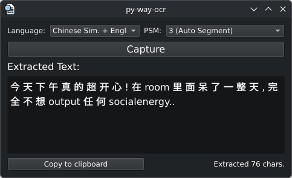
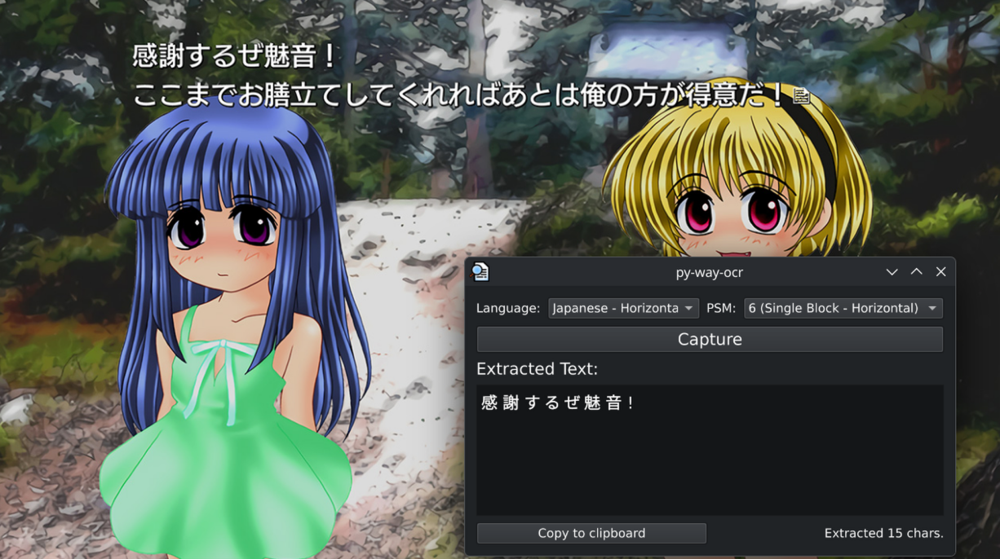

# py-way-ocr

Lightweight screen OCR tool for Linux (Wayland), built with **PySide6** and **Tesseract**. Select a region of your screen and get the text out of it.


-orange.svg)


<p align="center">
    
    
</p>

## Key Features

- Select any region of the screen and extract its text.
- Language list is built from the Tesseract language packs you have installed.
- Handy presets for mixed text: **Japanese + English** and **Chinese Simplified + English**.
- Adjustable Page Segmentation Mode (PSM) for different text layouts.
- Image preprocessing (grayscale, upscaling, contrast boost) for better accuracy.
- System tray icon with quick actions, plus a `Ctrl+S` shortcut for capturing.
- `--capture` flag to start a capture immediately on launch, handy for hotkeys.
- OCR runs in a worker thread, so the UI never freezes while you select a region.

## How It Works

1. The region is selected with `slurp` and captured with `grim`.
2. The image is preprocessed with Pillow.
3. Tesseract extracts the text, which shows up in the window ready to copy.

### Capture Backends

`slurp` + `grim` is the main capture method. On **KDE Plasma**, `grim` does not work because of compositor protocol limitations, so the app falls back to **Spectacle** if it is installed. Spectacle is an optional fallback, not a dependency.

External tools are launched with a cleaned environment (`LD_LIBRARY_PATH`, `QT_PLUGIN_PATH`, etc. are removed). PyInstaller overrides these variables, which would otherwise break the external binaries when running a bundled build.

## Tech Stack

- **GUI:** PySide6 (Qt6)
- **OCR:** Tesseract via pytesseract
- **Image processing:** Pillow
- **Screen capture:** slurp + grim (Spectacle fallback)

## Requirements

- Linux with a Wayland session
- Python 3.10+
- [`tesseract`](https://github.com/tesseract-ocr/tesseract) with the language data packs you need (check with `tesseract --list-langs`)
- [`slurp`](https://github.com/emersion/slurp) and [`grim`](https://sr.ht/~emersion/grim/)
- *(Optional)* `spectacle` for KDE Plasma

## Installation & Usage

1. **Clone the repository:**

   ```bash
   git clone https://github.com/FurkannAli/py-way-ocr.git
   cd py-way-ocr
   ```

2. **Install dependencies:**

   ```bash
   pip install -r requirements.txt
   ```

3. **Run the application:**

   ```bash
   python src/main.py
   ```

### Bind it to a hotkey

Launch with `--capture` to jump straight into region selection. The result appears in the window, which you can open from the tray icon. Bind it in your compositor, for example:

```ini
# Sway
bindsym $mod+Shift+t exec python3 /path/to/py-way-ocr/src/main.py --capture

# Hyprland
bind = SUPER SHIFT, T, exec, python3 /path/to/py-way-ocr/src/main.py --capture
```

## Building from Source (Optional)

To compile a standalone single-file binary:

```bash
pip install pyinstaller
pyinstaller --onefile --noconsole --name=py-way-ocr src/main.py
```

## Status

This project is a work in progress. Planned improvements:

- [ ] Copy the result automatically when launched with `--capture`
- [ ] Translation functionality


## License

Distributed under the MIT License.
